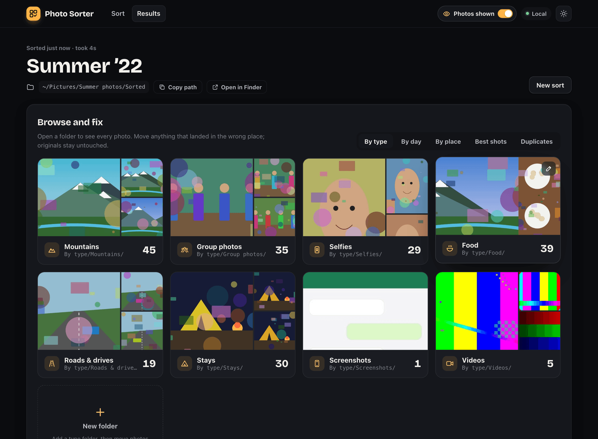
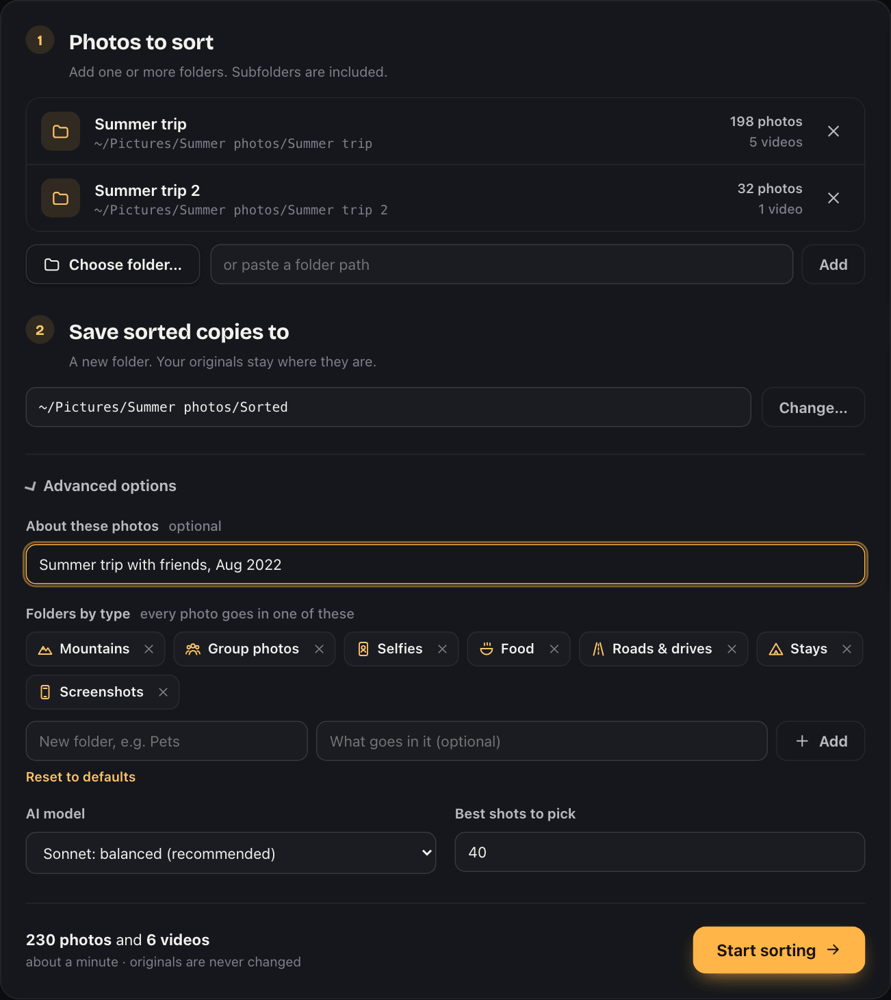
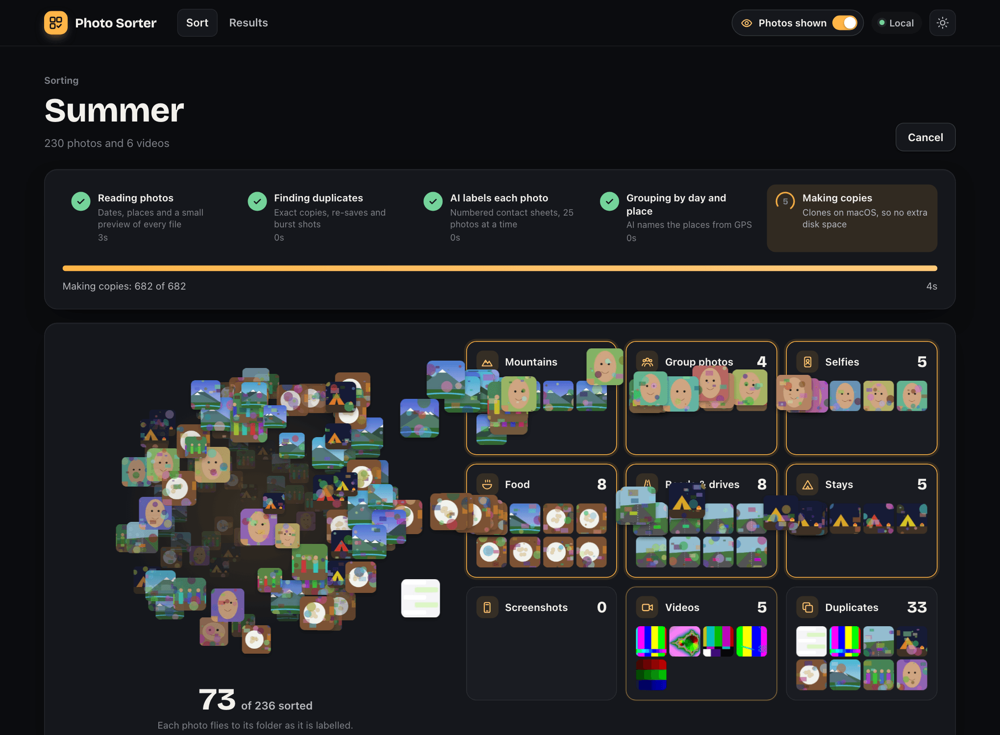
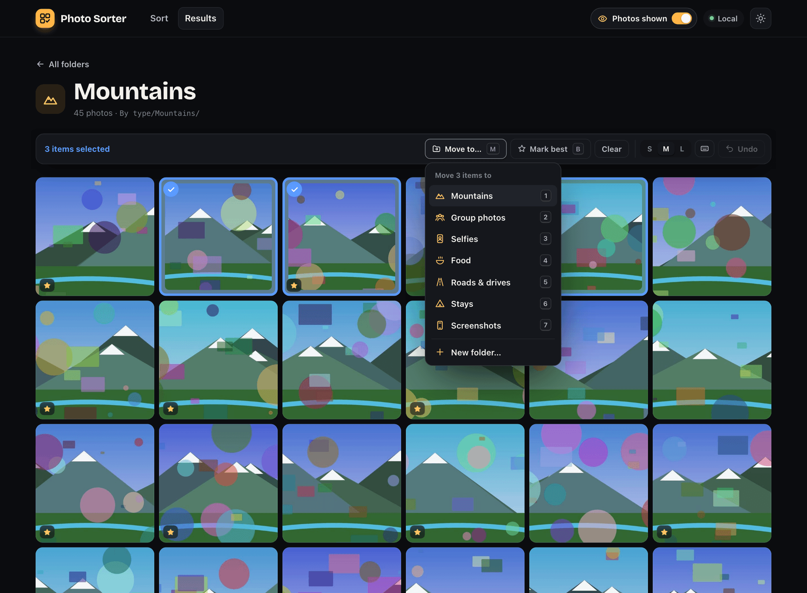
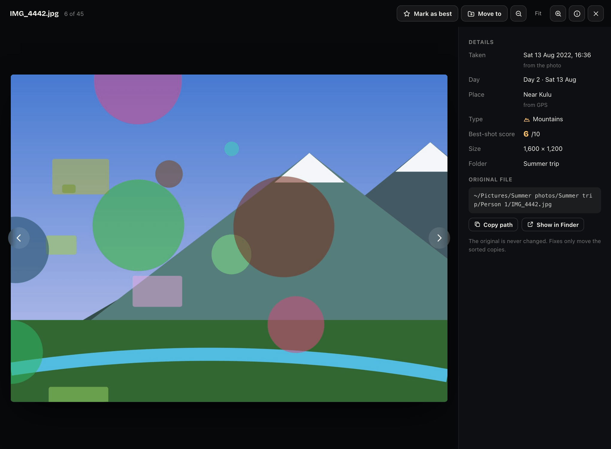
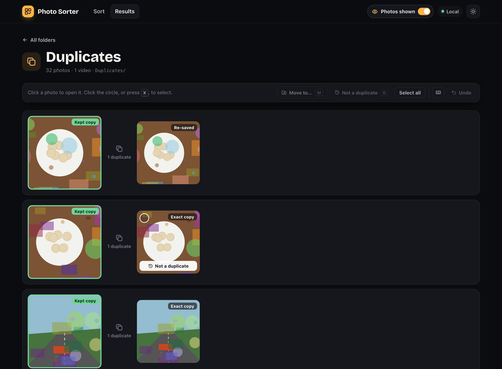

# Photo Sorter

Sort your photos with AI, on your own computer. Point it at a folder and it files a copy of every photo **by type**, **by day** and **by place**, picks your **best shots** and sets **duplicates** aside. Then browse every folder, open any photo full size, and fix anything that landed in the wrong place.

Your originals are never moved, edited or deleted, and they never leave your computer. To label photos, the AI sees small previews, the same as any image you share with it.



<sub>Screenshots use drawn placeholder images, not real photos.</sub>

## Features

- **By type**: every photo goes in one of your folders (Mountains, Group photos, Selfies, Food, Roads & drives, Stays, Screenshots by default; add, remove or rename your own).
- **By day**: `Day 1 – Fri 12 Aug`, `Day 2 – …` for a trip, or `2024/2024-03-09 Sat` for a whole camera roll.
- **By place**: GPS points are grouped and named ("Kasol", "Kheerganga trek", "Mandi highway"). Photos without GPS borrow the place of a photo taken within two hours.
- **Best shots**: every photo gets a keeper score; the top ones (40 by default) are spread across the days.
- **Duplicates**: exact copies, re-saved copies (WhatsApp and friends) and burst shots, each shown next to the copy that was kept.
- **Photo sphere**: while it sorts, your photos turn on a 3D sphere and fly into their folders as they are labelled. The whole sort plays back the same way when it is done.
- **Browse**: a fast grid for every folder (thousands of photos), and a full-size viewer with zoom, arrow keys and details.
- **Fix anything**: move photos to another folder, restore a duplicate, mark best shots, rename or add folders, and undo. Fixes are kept when you sort again.
- **Privacy switch**: one click hides every picture; photos then show only as 8×8 colour tiles.
- **Safe by design**: one module does every write, and it refuses any path outside the output folder. After each sort the app re-checks every original file.
- **No extra disk space** on macOS: copies are APFS clones.

## Quick start

### Requirements

- [Node.js 20+](https://nodejs.org)
- [Claude Code](https://claude.com/claude-code), installed and logged in (run `claude` once). The app uses it for the AI labels, so no API key is needed.
- Optional: `ffmpeg` for video thumbnails (`brew install ffmpeg`)

### Ask your coding agent

Open your coding agent in a terminal and paste:

```
Clone https://github.com/ashmitmittal/photo-sorter, run npm install, then npm start, and open http://127.0.0.1:8765 for me.
```

[AGENTS.md](AGENTS.md) has the setup steps and rules for agents.

### By hand

```bash
git clone https://github.com/ashmitmittal/photo-sorter.git
cd photo-sorter
npm install
npm start          # opens http://127.0.0.1:8765
```

On a Mac you can also double-click **Open Photo Sorter.command**.

## Using it



1. **Photos to sort**: press **Choose folder…** or paste a path. Add as many folders as you like; subfolders are included.
2. **Save sorted copies to**: defaults to a `Sorted` folder next to your photos.
3. **Advanced options** (optional): describe the photos ("Trip to Goa with college friends"), edit the type folders, pick the AI model and how many best shots you want.
4. Press **Start sorting**. It takes about 2 minutes for 1,000 photos with Sonnet.



Sorting again with the same folders is fast: previews and labels are cached in `data/`.

## Browsing



On the results page, pick **By type**, **By day**, **By place**, **Best shots** or **Duplicates** and open any folder. The grid only draws what is on screen, so folders with thousands of photos scroll smoothly. Use **S / M / L** for thumbnail size.

Click a photo to open the viewer:



- **← →** for the previous or next photo, **Esc** to close.
- Zoom with the scroll wheel or trackpad, double-click, or **+ − 0**; drag to move around.
- **I** shows or hides the details: date (and where it came from), day, place (from GPS or from a nearby photo), type, best-shot score, size and the original file's path, with **Copy path** and **Show in Finder**.
- Videos play right there.

## Fixes

Every fix changes only the sorted copies. Your originals are never touched.

- **Move to**: open the **Move to** menu (or press **M**) and pick a folder, or press **1–9** to send photos straight to folder 1–9. Works on one photo or on a selection. **New folder…** creates a folder and moves the photos into it in one step.
- **Select several**: click the circle on a photo or press **X**; **Shift**-click or **Shift + arrows** for a range, **⌘A** / **Ctrl+A** for all, **Esc** to clear.
- **Not a duplicate**: in **Duplicates**, each kept copy sits next to the copies set aside. Press **Not a duplicate** on one (or **D**) and it goes back into its type, day and place folders.

  

- **Best shots**: press **Mark best** (or **B**) to add a photo to `Best shots/`, or press it again to remove one.
- **Rename or add a type folder**: on **By type**, hover a folder and press the pencil to rename it, or press **New folder**.
- **Undo**: **⌘Z** / **Ctrl+Z**, or the **Undo** button, takes back the last fix. Press it again to go further back.
- **Kept on a re-sort**: fixes are saved in `data/fixes.json` and applied again the next time you sort the same files. Renamed and new folders carry over too, without labelling your photos again.

Each fix moves, adds or removes the right copies in `Sorted/`, then rewrites `sorted.csv`, `duplicates.csv` and `Sorted/.sorter-manifest.json`. The `fixed_by_you` column in `sorted.csv` marks what you changed. Press **?** in a folder to see every keyboard shortcut.

## What you get

```
Sorted/
  By type/      Mountains · Group photos · Selfies · Food · Roads & drives · Stays · Screenshots · Videos
  By day/       Day 1 – Fri 12 Aug · Day 2 – Sat 13 Aug · … · Undated
  By place/     Kasol · Kheerganga · Manikaran · … · No location
  Best shots/
  Duplicates/
  sorted.csv        every file: type, day, place, score, date and GPS source, original path, fixed by you
  duplicates.csv    every duplicate and the copy that was kept
```

A photo appears in several folders (its type, its day and its place). On macOS these are clones, so they use no extra space. Running a sort again replaces only the files listed in `Sorted/.sorter-manifest.json`.

## How it works

1. **Scan**: reads each file's date and GPS (EXIF, video metadata, file name) and makes a 640px preview in `data/previews/`. HEIC goes through `sips` on macOS; videos through `ffmpeg`.
2. **Duplicates**: same-size files are hashed; near-duplicates are found with perceptual and colour fingerprints, with bursts limited to shots taken within 20 seconds of each other.
3. **Labels**: previews are laid out on numbered contact sheets of 25 and the AI labels each sheet, four at a time, with structured JSON output.
4. **Days and places**: a trip gets `Day N` folders; a long camera roll gets dated folders. GPS points are clustered, and the AI names each cluster and the wider area in one call, using nearby towns from an offline gazetteer as hints. Places with only a few photos roll up into their area, such as "Mandi–Kullu highway". Only coordinates and times are sent for this step.
5. **Copies**: files are cloned into the folders, the CSVs are written, and every original is checked again (size and modified time).

## Privacy and safety

- Your originals never leave your computer. To label photos, the AI sees small previews (640px, on contact sheets), the same as any image you share with it.
- The server listens on `127.0.0.1` only and rejects requests from other sites.
- **Privacy switch**: the switch in the top bar hides every picture and shows 8×8 colour tiles instead. While it is on, every picture route refuses to answer. Your choice is remembered.
- **For screen recordings**: `npm start -- --privacy=on` locks privacy mode on for that session, so no real photo can appear. `--privacy=off` starts with photos shown.
- The app only serves pictures of files in the current sort, looked up by an ID; there is no way to ask it for any other file.
- Everything the app stores lives in `data/`: previews, thumbnails, full-size HEIC renditions (`data/full/`), labels, fixes and the last result. Delete it at any time.
- Want proof that nothing changed? `npm run snapshot` before and `npm run verify` after a sort compare SHA-256 checksums of every original.

## Command line

```bash
npm run sort -- "~/Pictures/Goa trip" --out="~/Pictures/Goa sorted" --context="Goa trip, Dec 2024"
```

| Option | Default |
|---|---|
| `--out=<folder>` | `Sorted` next to the first folder |
| `--context="…"` | none |
| `--model=sonnet\|opus\|haiku` | `sonnet` |
| `--labeler=mock` | real AI labels (`mock` makes random labels with no AI calls, for testing) |
| `--port=8765` | `8765` |
| `--privacy=on\|off` | the saved setting; photos are shown the first time (`on` locks it on) |

## Customising

- **Type folders**: edit them in *Advanced options*, rename or add them on the results page, or change the defaults in [`categories.json`](categories.json). Each folder has a name and a one-line description that the AI reads.
- **Environment variables**: `SORTER_MODEL` (labels, default `sonnet`), `SORTER_PLACES_MODEL` (place names, default `opus`), `SORTER_PARALLEL` (AI calls at once, default 4), `SORTER_DATA` (data folder), `SORTER_PORT`, `SORTER_PRIVACY` (`on` or `off`, same as the flag).

## Platforms

Made for macOS. It also runs on Linux and Windows: HEIC is converted with the bundled `heic-convert` (slower), copies are regular copies (they use disk space), **Choose folder…** asks you to paste a path instead, and the **Show in Finder** buttons are hidden. Browsing, the viewer and every fix work the same.

## Troubleshooting

- **The page says the AI tool is missing**: install the requirement above, run it once to log in, then reload the page.
- **Videos show grey tiles**: install `ffmpeg`. Videos are still sorted by day and place without it.
- **A video won’t play in the viewer**: some browsers can’t play every format (for example HEVC outside Safari and Chrome on a Mac). It is still sorted; open the copy in QuickTime or VLC.
- **A few photos landed in "Unsorted"**: a labelling call failed. Sort again to retry only those photos, or move them by hand.
- **Port in use**: `npm start -- --port=8780`.
- **A place name looks off**: delete `data/places-cache.json` and sort again to re-ask.
- **I added a folder and want everything re-labelled with it**: delete `data/labels-*.json` and sort again (this labels every photo again).

## Credits

Inspired by [kairothq/claude-photo-sorter](https://github.com/kairothq/claude-photo-sorter).

Town names for place hints come from [GeoNames](https://www.geonames.org) (cities with 5,000+ people), licensed under [CC BY 4.0](https://creativecommons.org/licenses/by/4.0/).

## License

[MIT](LICENSE)
